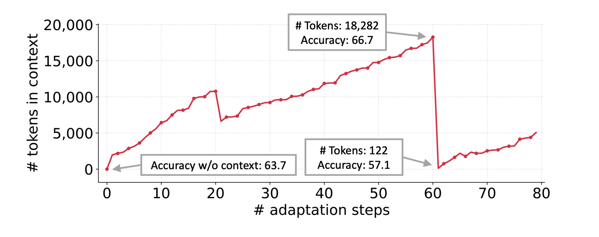
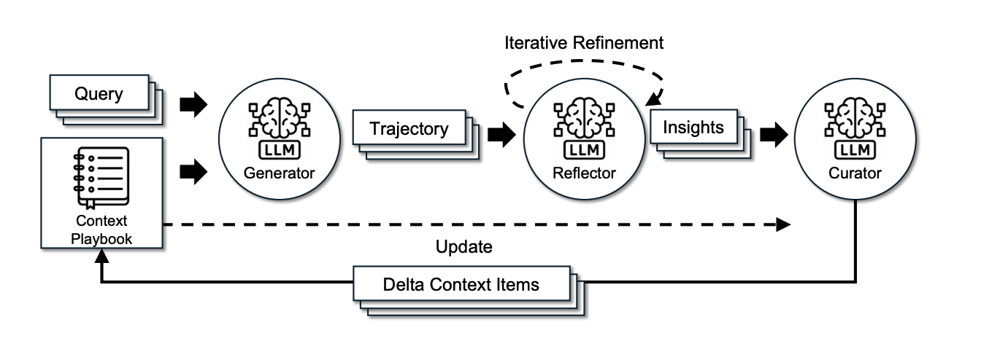
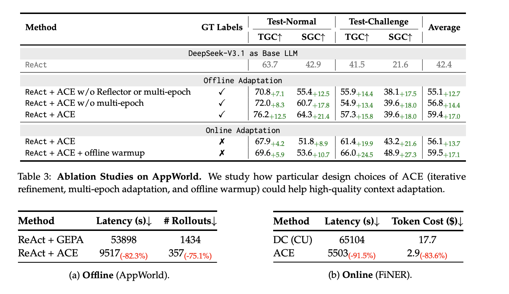

Currently, I develop AI agents at my company.

Although my primary role is as a backend developer, I am interested in AI and in improving overall team productivity.

My goal is to use AI agents to answer questions from other team members and to assist with server operations.

I have built an AI agent using LangChain, but I encountered a limitation: the agent does not retain previous conversation context. While LangChain provides features such as context summarization and memory modules, this led me to question how context should be designed and managed more effectively.

As a result, I began researching context engineering.

I then found an interesting paper: Agentic Context Engineering.

## Background

### Context Adaptation
Context adaptation (or context engineering) refers to methods that improve model behavior by constructing
or modifying inputs to an LLM, rather than altering its weights.

## Agentic Context Engineering (ACE)

### Introduction

Context engineering can reduce hallucination.

Existing approaches to context adaptation face two key limitations.

**Brevity Bias**: the tendency for instructions to collapse into short, generic commands like "Do a good job." While they look clean, they lack the domain-specific nuances required for complex tasks. This leads to a loss of critical information and causes the model to repeat the same errors.

**Context Collapse**: As the context grows, the model tends to compress it into much shorter, less informative summaries.


_source: [ACE](https://arxiv.org/pdf/2510.04618)_

The paper argues that context should work like a detailed, evolving playbook rather than a short summary. It should retain useful domain knowledge instead of compressing it away.

### Architecture of ACE

ACE uses a "Playbook," a collection of strategies, tips, and lessons that evolves over time.


_source: [ACE](https://arxiv.org/pdf/2510.04618)_


ACE divides context adaptation into three modular roles — Generator, Reflector, and Curator — that together build a structured, incrementally evolving playbook.

The **Generator** executes reasoning paths and identifies helpful and harmful patterns. The **Reflector** distills actionable lessons, and the **Curator** merges them into the global context using deterministic, non-LLM logic (e.g., semantic deduplication, pruning, and delta updates) to avoid context collapse and reduce costs.

- **Incremental Delta Updates**: Update only minimal, identifiable units rather than the full context, which reduces context drift and improves stability.

- **Grow-and-Refine**: Continuously accumulate knowledge while periodically pruning noise and redundancy to maintain the quality and compactness of the playbook.


After each run, the playbook is updated.

```json
{
  "skills": {
    "web_interaction_patterns-00001": {
      "id": "web_interaction_patterns-00001",
      "section": "web_interaction_patterns",
      "content": "Use shadowRoot.querySelector() for elements hidden in shadow DOM",
      "helpful": 2,
      "harmful": 0,
      "neutral": 0,
      "created_at": "2025-11-24T23:27:19.739470+00:00",
      "updated_at": "2025-11-24T23:27:19.739486+00:00"
    },
    "web_interaction_patterns-00002": {
      "id": "web_interaction_patterns-00002",
      "section": "web_interaction_patterns",
      "content": "Implement getAllShadowRoots() recursive traversal when querySelector fails",
      "helpful": 0,
      "harmful": 0,
      "neutral": 0,
      "created_at": "2025-11-24T23:27:19.739513+00:00",
      "updated_at": "2025-11-24T23:27:19.739518+00:00"
    }
  }
}
```

_source: [GitHub](https://github.com/kayba-ai/agentic-context-engine)_

### Results


_source: [ACE](https://arxiv.org/pdf/2510.04618)_

At first, I thought that using LLMs for all three roles—Generator, Reflector, and Curator—would be expensive to operate. However, the Curator uses deterministic logic rather than an LLM, which helps control the cost.

#### Code

[GitHub](https://github.com/kayba-ai/agentic-context-engine)

I implemented this using LangChain, but it does not work properly with LangChain v1.0 or later (2025-12-24).

The reason is that the following classes and methods have been deprecated in LangChain v1.x:
```python
from langchain.agents import AgentExecutor, create_tool_calling_agent
```

Related issue: [GitHub issue](https://github.com/kayba-ai/agentic-context-engine/issues/45)
