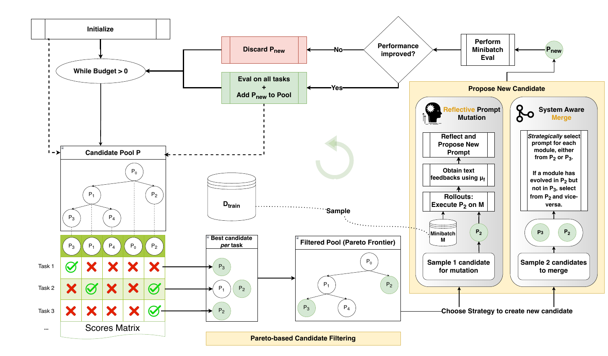
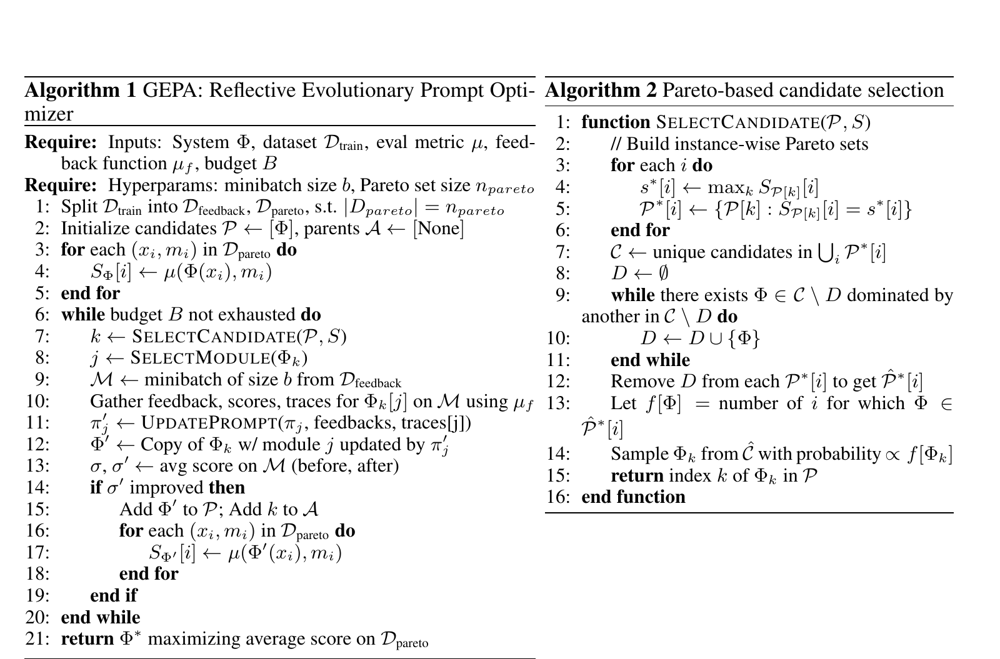

## Background

I am building an AI agent. To reduce inference cost, I replaced its language model with a smaller one. The agent still ran, but the old prompt became less reliable. The new model sometimes missed conditions that were already written in it.

I could keep editing the prompt and rerunning the same scenarios, but I wanted a more systematic approach.

That was why I started looking into automated prompt optimization and found [GEPA: Reflective Prompt Evolution Can Outperform Reinforcement Learning](https://arxiv.org/abs/2507.19457).

GEPA does not update the task model's weights. It collects execution traces and evaluation feedback, then asks a reflection model to propose a prompt change. It keeps the change only when the score improves.

This avoids weight training, but it is not free. GEPA still requires task-model rollouts, evaluator calls, validation runs, and calls to the reflection model.

Across six tasks, the paper reports that GEPA beat GRPO by 6% on average and by up to 20%. It also used up to 35 times fewer rollouts. These results come from the paper's experimental settings. They do not guarantee that every GEPA run will be cheaper or faster.

I have not completed the experiment on my agent yet. This post covers the algorithm, what I initially misunderstood, and what I still need to apply it.

## How GEPA works

Figure 3 summarizes the complete loop.


_The complete GEPA workflow from the [GEPA paper](https://arxiv.org/abs/2507.19457), Figure 3._

GEPA scores the candidate pool, applies the Pareto filter, and selects a parent. It then proposes a new candidate and tests it on a minibatch. An improved candidate is evaluated on the full selection set and added to the pool. Figure 3 also shows GEPA+Merge, but this post follows the standard reflective-mutation path.

Figure 4 provides the pseudocode behind that overview.


_Algorithm 1 and Algorithm 2 from the [GEPA paper](https://arxiv.org/abs/2507.19457), Figure 4._

- **Algorithm 1** runs the optimization loop and decides whether to keep a new prompt.
- **Algorithm 2** selects the existing candidate to modify next.

For the core loop, think of a candidate as one prompt version and a task instance as one evaluation example. Pareto selection chooses the parent. A later minibatch comparison decides whether its child enters the pool.

### 1. Split the input data by purpose

Algorithm 1 splits `D_train` into two subsets before optimization. This is a data split, not an LLM classification step.

- `D_feedback` provides examples for prompt mutation. GEPA samples a small minibatch from it, runs the selected parent, and sends the resulting inputs, outputs, traces, scores, and feedback to the reflection model.
- `D_pareto` provides the per-example scores used to compare candidates, build the Pareto winner sets, and select the final prompt.

The pseudocode, experiments, and current API describe this split differently:

| Context | Feedback data | Pareto selection data |
|---|---|---|
| Algorithm 1 pseudocode | A subset split from `D_train` | Another subset split from `D_train`, with size `n_pareto` |
| Paper experiments | The benchmark's training split | The benchmark's validation split |
| Current GEPA API | `trainset` | `valset`; if omitted, the implementation reuses `trainset` |

Algorithm 1 sets the size of `D_pareto` but does not say how to sample it. In the experiments, the benchmark training split becomes `D_feedback`, the validation split becomes `D_pareto`, and a separate test set is used for final reporting. The current API can reuse `trainset` when `valset` is omitted, although the FAQ recommends keeping them separate.

### 2. Evaluate the seed prompt

GEPA starts with a seed candidate. In the simplest setup, this is the original system prompt.

```python
seed_candidate = {
    "system_prompt": "You are a helpful assistant...",
}
```

GEPA runs the seed on every `D_pareto` example. A user-supplied evaluator returns one score per example, creating the first row of the candidate-by-example score table. The evaluator may use an LLM, but it does not have to.

### 3. Select a parent with the Pareto algorithm

Algorithm 2 chooses one existing candidate as the parent. It does not simply choose the highest average score. It uses the per-example `D_pareto` scores.

Consider this example. These are not paper results.

| Candidate | Case 1 | Case 2 | Case 3 | Average |
|---|---:|---:|---:|---:|
| `P0` | 1.0 | 0.0 | 0.5 | 0.50 |
| `P1` | 1.0 | 1.0 | 0.3 | 0.77 |
| `P2` | 0.8 | 0.7 | 0.9 | 0.80 |

The best candidates for each case are:

```text
Case 1: P0 and P1
Case 2: P1
Case 3: P2
```

Ties are kept, so `P0` and `P1` both win Case 1. The [official implementation](https://github.com/gepa-ai/gepa/blob/b265bf9ca77fd8e8d82039d9f74911b8780fe1ce/src/gepa/gepa_utils.py#L40-L128) then removes a candidate only when every case it wins still has another surviving winner. It checks lower aggregate scores first and always leaves at least one winner per case.

Here, `P0` can be removed because `P1` also wins Case 1. The survivors are `P1` and `P2`. `P1` appears in two winner sets and `P2` in one, producing a sampling list equivalent to `[P1, P1, P2]`. Their parent-selection probabilities are therefore two-thirds and one-third.

This probability applies only to parent selection. Pool admission happens later.

### 4. Select the prompt to update

After Algorithm 2 chooses a parent, `SelectModule` chooses which prompt inside it to update. Round-robin does not select the parent again.

This step exists because the paper supports systems with several LLM prompts. For example, a query rewriter and an answer generator may use different prompts. Round-robin moves through them one at a time.

```text
Pareto candidate selection: Which candidate should be the parent?
Round-robin module selection: Which prompt in that parent should be updated?
```

If the system has one prompt, round-robin has no practical effect. The same prompt is selected every time.

### 5. Sample a feedback minibatch

GEPA samples `b` examples from `D_feedback`; the paper experiments use three. It runs the parent and collects inputs, outputs, tool or module traces, scores, errors, and textual feedback. The paper calls model-generated steps the execution trace and evaluator output the evaluation trace. Both provide more information than a score alone.

### 6. Evaluate the outputs with a custom evaluator

GEPA only requires a numeric score where higher is better. The evaluator can use:

- **Deterministic checks:** The current `DefaultAdapter` includes a `ContainsAnswerEvaluator`. Similar code can validate JSON, required fields, tool names, IDs, or token limits.
- **LLM-as-a-judge:** An LLM can score subjective requirements and return detailed feedback. The FAQ recommends calibrating it with a small human-annotated dataset.
- **A hybrid:** Code handles hard constraints, while an LLM judge evaluates qualities that are difficult to express as rules.

The feedback matters as much as the score. `0.4` only says that something went wrong. The following feedback says what to fix:

```text
The response used a valid tool name and stayed within the token limit.
However, it ignored a required constraint from the input.
It also mentioned a fact that was not present in the tool output.
```

GEPA calls this diagnostic context Actionable Side Information, or ASI. It can include expected and actual outputs, errors, violated constraints, and separate objective scores.

### 7. Let the reflection model propose a new prompt

The reflection model receives the selected prompt, inputs, outputs, traces, and feedback. It proposes a revised instruction. GEPA copies the parent and replaces only the selected prompt. Standard reflective mutation uses one parent; GEPA+Merge is a separate variant.

### 8. Compare the parent and the child

The child is evaluated on the same feedback minibatch as its parent. Under the default `strict_improvement` rule, an equal or lower score is rejected. An improved child enters the pool and is evaluated on all of `D_pareto`. GEPA repeats the loop until the budget is exhausted, then returns the candidate with the best average `D_pareto` score.

## Conclusion

### What I am trying

The official FAQ lists model migration as a GEPA use case: switch the task model, keep the program structure, and optimize the prompt again. That is close to my situation.

I first considered two seeds. One was the existing prompt, including parts tuned for the previous model. The other was a minimal prompt that described the task and output format with as few tokens as possible.

The [FAQ's seed guidance](https://gepa-ai.github.io/gepa/guides/faq/#how-does-the-seed-prompt-affect-optimization) gave me a useful boundary. I keep the task rules, tool constraints, and output contract. I leave the exact procedure and wording open to optimization. I also keep the original prompt as a baseline.

Prompt length needs its own constraint. [GEPA does not optimize for brevity by default](https://gepa-ai.github.io/gepa/guides/faq/#does-gepa-aim-for-brevity-in-prompts), and early candidates can be long. I plan to measure token cost, limit proposal length, and ask for small targeted edits rather than full rewrites.

### Why evaluation is still difficult

Consider a hypothetical recommendation system. This is only an example, not a description of my agent. A user might ask for the cheapest option, while the product policy could require the system to balance price with permitted preference signals and explain the trade-off.

A deterministic evaluator could check hard constraints. An LLM judge could assess the recommendation and explanation. GEPA can optimize against those signals, but it cannot decide what the product should value. That policy must already be visible in the dataset and evaluator.

The [official FAQ recommends roughly 30 to 300 examples](https://gepa-ai.github.io/gepa/guides/faq/#can-gepa-work-with-very-few-examples) for better results. The number alone is not enough. For a tool-using agent, the data may also need the path from input to final answer:

```text
User request
-> user context available to the agent
-> tool name and arguments
-> tool message and tool response
-> ranking or decision made from that response
-> final answer
-> evaluation feedback
```

The [trace guidance](https://gepa-ai.github.io/gepa/guides/faq/#how-should-i-serialize-agent-traces-for-gepa) recommends recording relevant state changes, decisions, outputs, and failures. The feedback must also identify where the failure happened. Otherwise, the reflection model may try to fix the wrong step.

This brought back a lesson from my year-long undergraduate internship in a computer vision lab. It was easy to focus on the model and training code, but dataset quality often decided what the model could learn. GEPA changes prompts instead of weights, but it still learns only from the examples and feedback I provide.

### My next step

I will start with a narrow experiment:

1. Keep the current agent flow and the smaller task model.
2. Use the existing prompt as a baseline and optimize one prompt first.
3. Build a small dataset with the relevant tool trajectory.
4. Combine deterministic checks with an LLM judge.
5. Track prompt length and use separate feedback, validation, and test data.
6. Review accepted prompts and run regression cases before deployment.

I am still tuning the prompt, and I remain skeptical about whether the result will be reliable enough to adopt. My first goal is only to test one well-defined prompt. For now, the main bottleneck is not GEPA's mutation algorithm. It is building a dataset and evaluator that reward the behavior I actually want.

### References

- [GEPA paper](https://arxiv.org/abs/2507.19457)
- [GEPA official repository](https://github.com/gepa-ai/gepa)
- [GEPA paper artifact](https://github.com/gepa-ai/gepa-artifact)
- [GEPA FAQ](https://gepa-ai.github.io/gepa/guides/faq/)
- [Creating GEPA adapters](https://gepa-ai.github.io/gepa/guides/adapters/)
- [Default evaluator implementation](https://github.com/gepa-ai/gepa/blob/b265bf9ca77fd8e8d82039d9f74911b8780fe1ce/src/gepa/adapters/default_adapter/default_adapter.py#L49-L74)
- [Strict improvement acceptance rule](https://github.com/gepa-ai/gepa/blob/b265bf9ca77fd8e8d82039d9f74911b8780fe1ce/src/gepa/strategies/acceptance.py#L44-L53)
