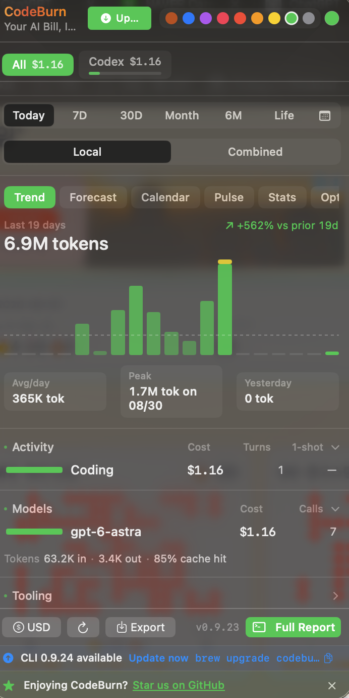
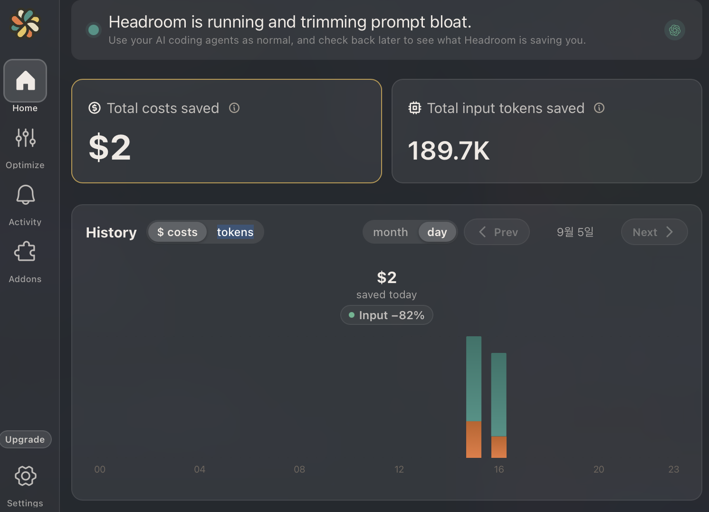

I use AI coding agents both at work and for personal game development.
Recently, my company introduced a monthly token usage limit of $200.
I soon realized that if I continued using AI agents in the same way as before, I would quickly reach the limit.

This made me look for open-source tools and skills that could help me track and reduce token usage.
I also tried running a local model, `qwen3-30b-coder-4bit`, with Rapid MLX, but the attempt did not work as I expected.

In this post, I want to share the tools and approaches I found while learning how to manage tokens more carefully.

<!--
English practice 1: Background

다음 의미를 영어 1~2문장으로 직접 써 보세요.
"예전에는 토큰 사용량을 크게 신경 쓰지 않았지만, 사용 한도가 생긴 후부터 관리의 필요성을 느꼈다."

Useful patterns:
- I did not pay much attention to ... before.
- Once ..., I realized that ...

Write here:
Once introducing token usage limit, I realized that token manaing.

-->

## Caveman Skill: Reducing Output Tokens

I learned about the Caveman skill while making a game with a friend.
My friend introduced it to me as a way to reduce the length of an AI agent's responses.

The basic idea is to make the agent speak like a caveman: use short and simple expressions instead of complex modifiers and sentence endings.
This can be especially helpful for reducing output tokens.

This matters because output tokens can cost about five times as much as input tokens, depending on the model.
Reducing unnecessary output can therefore have a greater effect on the total cost than reducing the same number of input tokens.
However, this approach may not be suitable for every task.
For a very simple task, explaining and activating the skill could use more tokens than it saves.

<!--
English practice 2: Explaining a trade-off

아래 빈칸을 채워 문장을 완성해 보세요.

This approach works well when complex coding or work.
However, it may not be useful when simple task.

Useful patterns:
- This approach works well when ...
- It may not be suitable for ...
- The setup cost can be greater than the benefit.
-->

## CodeBurn: Monitoring Token Usage

CodeBurn helped me monitor token usage.
By checking the report, I could see where tokens were being used or wasted instead of relying only on guesswork.

The dashboard shows information such as total token usage, average daily usage, peak usage, input and output tokens, cost, and cache hit rate.
This makes it easier to identify unusual usage patterns and determine which models or activities are consuming the most tokens.

CodeBurn also provides suggestions for optimizing token usage.
For example, it may recommend removing unused skills or MCP servers that add unnecessary context to an agent's requests.
Instead of only showing how many tokens I used, it gives me practical ideas for reducing future usage.

<!--
English practice 3: Describe the screenshot

스크린샷에서 실제로 확인할 수 있는 내용을 영어로 1~2문장 작성해 보세요.
확실하지 않은 기능이나 수치는 추가하지 마세요.

Useful patterns:
- The report shows how many tokens ...
- I noticed that most of the tokens were used for ...
- This information helped me identify ...

Write here:

Model answer:
It also suggests ways to optimize token usage. For example, it may recommend removing unused skills or MCP servers.

-->

## Headroom: Looking for More Optimization

I also looked into Headroom as another way to optimize token usage.
It runs as a proxy between an AI coding agent and the model provider.
The agent still reads files and runs tools in the usual way, but Headroom examines their results before sending the request to the model.
Its `ContentRouter` detects each type of content and selects a specialized compressor.

### How Does It Handle Source Code?

Headroom does not reduce tokens by preventing the agent from reading source files.
When code compression is applied, `CodeAwareCompressor` parses the code into an abstract syntax tree, or AST, using tree-sitter.
It preserves structural information such as imports, function signatures, class definitions, type annotations, and decorators.
Function bodies, comments, and long docstrings are the parts that can be shortened.
Unlike simple truncation, this approach is intended to keep the resulting code syntactically valid.

However, the official limitations are important.
Recent code and code related to requests such as “analyze,” “review,” “fix,” or “debug” are normally protected from compression.
Short code blocks also pass through unchanged.
Therefore, Headroom may save little in a code-only session; its largest savings often come from accumulated tool outputs rather than the source code currently being edited.

### How Does It Compress JSON?

Headroom routes JSON arrays to a component called `SmartCrusher`.
It first tries a lossless method for tabular arrays whose items share a consistent set of keys.
In this case, it converts the data into a compact CSV-like representation while keeping every item.

If that method does not save enough space, it uses a selective method.
It keeps the first and last items, errors, statistical anomalies, items relevant to the user's query, and significant changes in the data.
Duplicate or less informative items can then be sampled or removed.

The strategy also depends on the array type.
String arrays can be deduplicated and sampled, numeric arrays can be replaced with statistical summaries while preserving outliers and change points, and mixed arrays are compressed by grouping similar types.
Small arrays, malformed JSON, and JSON objects without arrays normally pass through unchanged.

### What Else Does It Compress?

Headroom uses separate compressors for other tool outputs.
For build and test logs, it preserves errors, warnings, stack traces, and summary lines while removing repeated success messages.
For search results, it prioritizes exact matches, relevant results, and results from different files.
For diffs, it keeps changed lines and enough surrounding context to understand them.

Headroom also provides reversible compression through a feature called CCR, which stands for Compress-Cache-Retrieve.
The original content is stored locally with a hash, while the model initially receives a smaller representation and a retrieval marker.
If more detail is required, the model can use the `headroom_retrieve` tool to request the original content.
The complete automatic retrieval loop is available when Headroom is used through its proxy.

The screenshot below shows the result from my environment.
Headroom reported an 82% reduction in input tokens, with 189.7K input tokens and an estimated $2 saved during this run.
This is my own result, not a guaranteed compression rate for every workload.

For more information, see the official documentation about the [proxy](https://docs.headroomlabs.ai/docs/proxy), [compression pipeline](https://docs.headroomlabs.ai/docs/how-compression-works), [code compression](https://docs.headroomlabs.ai/docs/code-compression), [SmartCrusher](https://docs.headroomlabs.ai/docs/smart-crusher), [CCR](https://docs.headroomlabs.ai/docs/ccr), and [limitations](https://docs.headroomlabs.ai/docs/limitations).

<!--
English practice 4: Explain what you learned

다음 질문에 영어로 답해 보세요.

1. What does the 82% reduction mean in this report?
2. How did Headroom change your token usage?

Useful patterns:
- According to the report, ...
- It reduced ... by approximately ...
- I need more data before I can conclude that ...

Write here:

-->

## What I Learned

The AI landscape is changing very quickly.
New tools and techniques appear all the time, so I believe it is important to find the ones that fit my needs and try them myself.
Reading about a tool is useful, but hands-on experience helps me understand whether it actually works in my environment.

For example, we tried Headroom at my company, but it reduced our token usage by only about 3%.
This result was very different from the larger reduction shown in my personal test.
Headroom has official documentation and published results, but its effectiveness can still vary depending on the workload and environment.
This experience reminded me that credible information is a useful starting point, but I should also verify a tool by using it myself.

It is also difficult for one person to discover and evaluate every open-source tool.
Sharing useful tools with others and trying them together can be more effective than researching everything alone.
For this reason, I shared these tools with my team so that we could evaluate them together and learn from one another's experiences.

<!--
Final practice: Reuse these conclusion patterns

이번 결론에서 다음 표현을 기억해 보세요.

- The AI landscape is changing very quickly.
- It is important to find the tools that fit my needs and try them myself.
- Its effectiveness can vary depending on the workload and environment.
- This experience reminded me that ...
- We can learn from one another's experiences.

Practice:
"공식 자료는 좋은 출발점이지만, 실제 환경에서 직접 확인해야 한다"를 위 패턴을 사용해 다시 써 보세요.

-->
